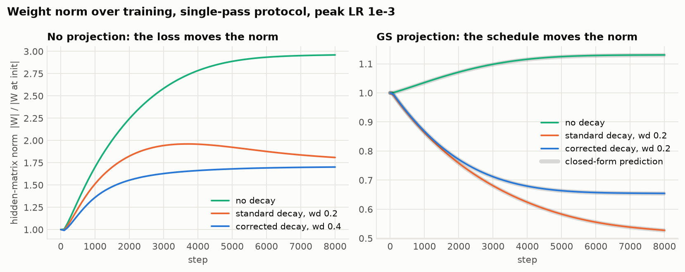
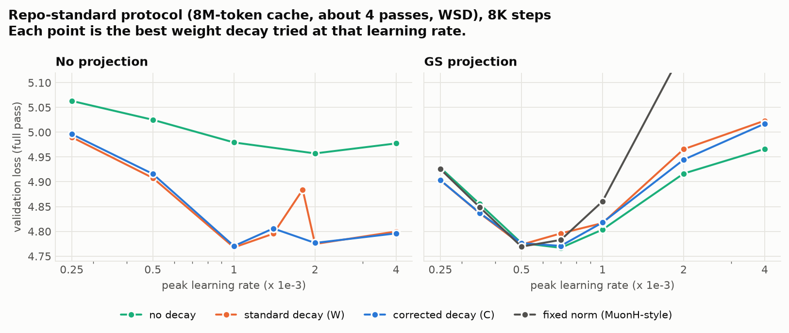
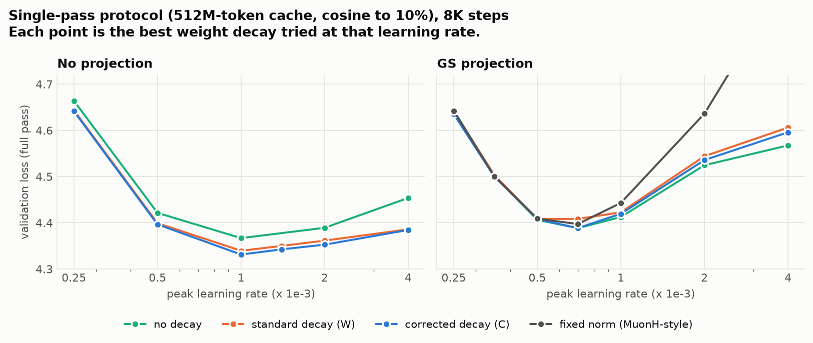
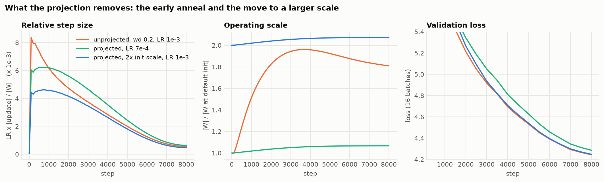
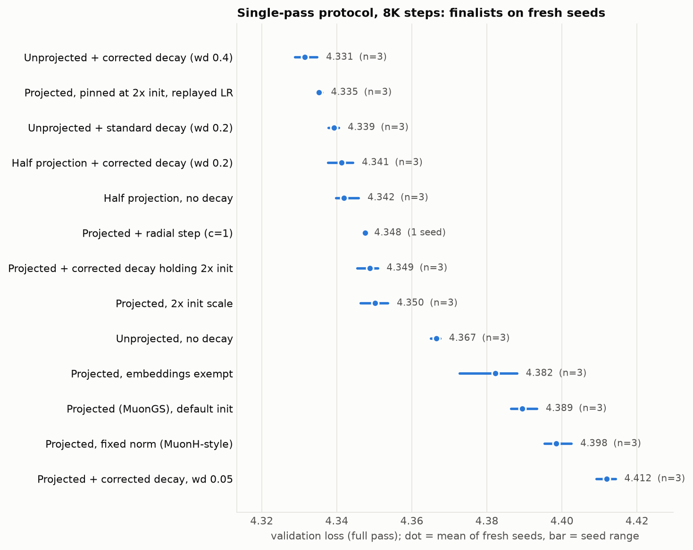
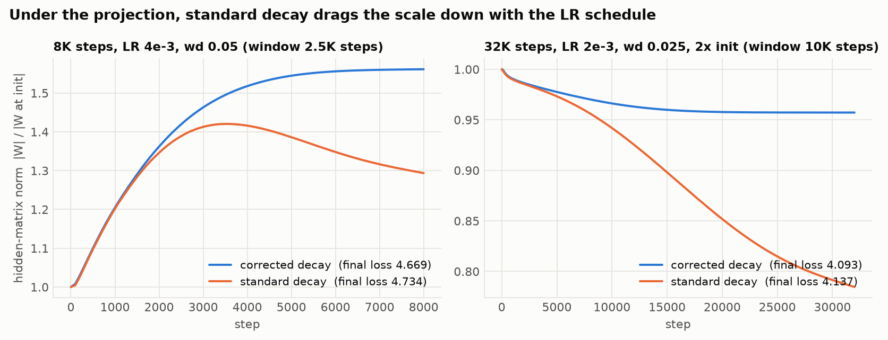
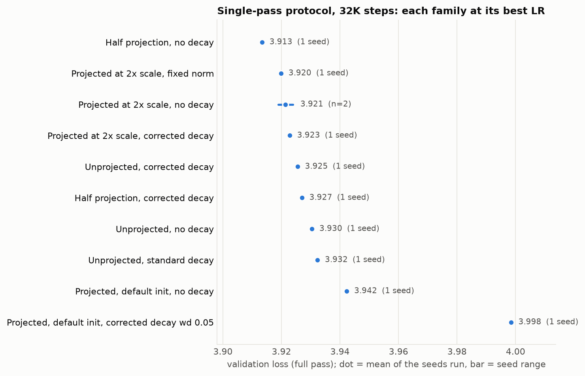

# MuonC x MuonGS: how should corrected decay and the tangent projection be combined?

Worker: `claude_muonc_gs`. Code: [`muonc.py`](../../muonc.py) (root, shippable),
[`muonc_research.py`](muonc_research.py) (experiment-only variants),
[`experiments/`](experiments/). Result bundle:
[`results/muonc_gs_fineweb_gpt2_20261109/`](results/muonc_gs_fineweb_gpt2_20261109/)
(`summary.md` holds every table; `summary.csv` every trial).

The H-Net trainer's `MuonC` puts two ideas on top of Muon:

- **GS**, the MuonGS tangent projection (arXiv:2610.37647): remove the part of
  the update that is parallel to the weight, `N' = N - <W,N>/|W|^2 * W`.
- **C**, corrected decoupled decay (arXiv:2506.02285): decay by
  `1 - wd * lr_t^2 / lr_max` instead of `1 - wd * lr_t`.

Neither paper tests the other's idea. This study asks whether they belong
together and how to configure the pair.

## Answer

1. **They fit together exactly, and if you project you should use C, not W.**
   With the projection the weight norm stops depending on the loss. It follows
   `|W|^2 <- f^2 |W|^2 + lr^2 |N'|^2`, which reproduces the measured final
   norm of all 136 fully projected runs (median error 0.03%). Both terms are
   second order in the learning rate only under corrected decay, so only C
   gives a fixed point that does not move with the schedule. Under standard
   decay the scale sinks as the LR decays, and that costs loss once the run is
   longer than the norm's relaxation time (4.669 against 4.734 at 8K steps
   and 4.093 against 4.137 at 32K steps in the two pairs set up to test it).
2. **Under the projection, weight decay is not a regularizer. It selects the
   operating scale of every projected matrix:**
   `RMS = 0.2 * sqrt(lr_max / (2 * wd))`, reached over about
   `1 / (2 * wd * lr_max)` steps. `MuonC.equilibrium_rms` and
   `MuonC.weight_decay_for_rms` compute it. With the H-Net values (`lr 1.2e-3`,
   `wd 0.05`) that is RMS 0.022 after about 8K steps, whatever the
   initialisation was, including depth-scaled residual outputs.
3. **The full projection is not free.** It removes two things the loss gets
   from norm growth in unprojected Muon: a move to a larger operating scale
   (about 2x the default init here) and an implicit learning-rate anneal. On
   the single-pass protocol that costs 0.05 to 0.08 nats at 8K steps against
   unprojected Muon with tuned decay. Supply both by hand and the projected
   optimizer matches it. At 32K steps the projected optimizer at 2x scale is
   level with or slightly ahead of unprojected Muon (3.921 against 3.926).
4. **Do not project a matrix that sets the output scale.** Projecting the tied
   embedding/unembedding is what turned the H-Net stack's switch to `MuonC`
   into a 0.22-nat regression on this proxy. With that one matrix exempt the
   regression is gone. H-Net itself has no embedding on the Muon path and keeps
   `lm_head` on the fallback, so this failure should not transfer to it.
5. **Two ways to combine them that reached the unprojected optimum here:**
   half-strength projection (`gs_projection=0.5`) with corrected decay, which
   lets the loss keep choosing the scale; or the full projection with the
   scale set deliberately (initialise at the scale you want and pick `wd` from
   the formula in point 2). The default recipe (full projection, default init,
   `wd 0.05`) was the worst of the projected options.
6. **On the repo's standard multi-pass protocol everything well tuned ties**,
   and the README's Muon baseline was under-regularised: plain MuonW at
   `wd 0.4, lr 1e-3` reaches 4.768 against 4.88-4.89 at the README's
   `wd 0.05`, which is also below every result in the README's tables.

At 8K steps nothing projected beats tuned unprojected Muon. At 32K steps the
half projection and the full projection at the right scale are ahead by one
to three seed standard deviations, which is suggestive and not more. The
firm case for GS + C is control: norms that are a known function of the
schedule, an angular step that follows the nominal LR, and one less
interaction to tune. The learning-rate schedule itself is a much larger
effect than any of these choices (section 7).

## What was compared

All runs share one Muon direction (Nesterov momentum 0.95, Gram Newton-Schulz,
`0.2 * sqrt(max(rows, cols))` scale), the repo runner's parameter routing
(every matrix on the Muon path, including the tied embedding; LayerNorm gains
and biases on Adam), and the same initialisation and batch order per seed.

| | no decay | standard decay (W) | corrected decay (C) |
|---|---|---|---|
| **no projection** | Muon | MuonW (repo "Plain Muon") | corrected-decay Muon |
| **GS projection** | MuonGS (the paper) | GS + W | GS + C (H-Net's `MuonC`) |

plus a fixed-norm reference (projection, then rescale to the initial norm:
MuonH-style), partial and one-sided projection, an adaptive radial step, the
H-Net stack (PMuonEq + NorMuon + SODA, AdamATan2 fallback at half LR, BF16
GramNS), and interventions on initial scale, embedding routing and schedule.

Model and data are the README's tokenized benchmark: 51M-parameter GPT
(8 layers, width 512, context 256, GPT-2 vocabulary, tied embeddings),
FineWeb-Edu, batch `16 x 256`, BF16 autocast, gradient clipping at 1.0.

| Protocol | Train tokens | Schedule | Why |
|---|---|---|---|
| `std` | 8M (about 4 passes in 8K steps) | 100-step warmup, constant, last 20% linear to 10% | the README's protocol; comparable with its 8K-replay tables |
| `sp` | 512M (single-pass regime) | 100-step warmup, cosine to 10% | no overfitting; the H-Net trainer's schedule shape |
| `sp`, 32K steps | 512M | same | does the ranking move with horizon? |

Selection and noise: grids were run on seed 123. Finalists were re-run on
seeds 124-126 and the fresh-seed mean is what the tables report, because the
minimum of a single-seed grid is biased low. Seed standard deviation is about
0.008 on `std` and 0.002-0.004 on `sp`.

Validation of the harness: the repo's own `PlainMuon` inside this loop gives
4.8976 on seed 123 against the README's 4.8973, and this port configured as
plain MuonW is statistically the same optimizer (4.8841 +/- 0.0063 against
4.8895 +/- 0.0101 over five seeds; it is not bit-identical because the H-Net
GramNS uses the direct recurrence).

## Mechanics

**The Muon direction has a persistent outward radial component.** From step 1K
on, the cosine between weight and direction is negative in every one of the
113 unprojected 8K-step runs: -0.02 to -0.14 through mid-run, fading to about
-0.01 as the LR decays. A relative step is about 0.005-0.01, so this
first-order drift, not the second-order term, is what moves the norm. At the
best settings unprojected norms end between 1.6x (strong decay) and 8.5x (no
decay) their initial value, while the projected norm without decay moves by
7-14%.

**With the projection the norm is a function of the schedule alone.** The
update is exactly orthogonal to the weight, so

```text
|W_{t+1}|^2 = f_t^2 |W_t|^2 + lr_t^2 |N'_t|^2
f_t = 1                              no decay:   grows like sqrt(t)
f_t = 1 - wd * lr_t                  standard:   fixed point 0.2 sqrt(lr_t  / (2 wd)) RMS, moves with the schedule
f_t = 1 - wd * lr_t^2 / lr_max       corrected:  fixed point 0.2 sqrt(lr_max / (2 wd)) RMS, does not
```

`|N'|` is known in advance (RMS entry 0.18-0.2 at this update scale), so the
recursion predicts the norm without reference to the loss. A unit test checks
the identity step by step; across the 136 fully projected runs the predicted
final norm is within 0.03% of the measured one at the median (1.5% at worst,
with the direction norm sampled every 100 steps).
The relaxation time is `1 / (2 wd lr_max)` steps, which equals
`1 / theta^2` for the equilibrium angular step `theta = sqrt(2 wd lr_max)`: a
run at a small angular step stays near its initial scale for a long time.



The left panel is the corrected-decay paper's effect without any projection:
standard decay lets the norm overshoot and then fall as the LR decays, while
corrected decay plateaus.

## Results

All tables are in `results/muonc_gs_fineweb_gpt2_20261109/summary.md`.
"Fresh seeds" means seeds 124-126; the configuration was chosen on seed 123.

### 1. Repo-standard protocol: everything well tuned ties

| Configuration (best LR, wd) | Val loss, fresh seeds | Hidden norm vs init |
|---|---:|---:|
| Projected, no decay (MuonGS), LR 7e-4 | 4.7667 +/- 0.0075 | 1.14 |
| Projected, fixed norm, LR 5e-4 | 4.7678 +/- 0.0091 | 1.00 |
| Unprojected, standard decay wd 0.4, LR 1e-3 | 4.7682 +/- 0.0054 | 1.58 |
| Projected, corrected decay wd 0.0125, LR 7e-4 | 4.7703 +/- 0.0043 | 1.08 |
| MuonW at the README settings (wd 0.05, LR 1.8e-3), this port | 4.8823 +/- 0.0053 | 5.64 |
| Repo `PlainMuon` at the README settings | 4.8875 +/- 0.0104 | 5.63 |
| Unprojected, no decay, LR 2e-3 (seed 123 only) | 4.9572 | 8.51 |
| Repo AdamW at the README settings (seed 123 only) | 5.0961 | 1.90 |

Norm control is worth about 0.12 nats on this protocol and it does not matter
how it is obtained. The README baseline lets norms grow 5.6x; eight times more
weight decay or the projection both fix that. The data is seen about four
times, so anything that lets norms grow overfits: the projection with
embeddings exempt scores 4.8835 and with the radial step 4.9208.



### 2. Single-pass protocol: the full projection costs 0.05 to 0.08 nats

| Configuration (best LR, wd) | Val loss, fresh seeds | Hidden norm vs init |
|---|---:|---:|
| Unprojected, corrected decay wd 0.4, LR 1e-3 | 4.3315 +/- 0.0030 | 1.70 |
| Unprojected, standard decay wd 0.2, LR 1e-3 | 4.3392 +/- 0.0014 | 1.81 |
| Half projection, corrected decay wd 0.2, LR 1e-3 | 4.3412 +/- 0.0034 | 1.57 |
| Half projection, no decay, LR 1e-3 | 4.3419 +/- 0.0034 | 2.21 |
| Unprojected, no decay, LR 1e-3 | 4.3665 +/- 0.0013 | 2.96 |
| Projected, no decay (MuonGS), LR 7e-4 | 4.3894 +/- 0.0036 | 1.07 |
| Projected, fixed norm, LR 7e-4 | 4.3984 +/- 0.0037 | 1.00 |
| Projected, corrected decay wd 0.05, LR 5e-4 | 4.4119 +/- 0.0026 | 0.96 |



Without the projection, decay helps (4.367 to 4.33-4.34) and corrected decay
with its own best `wd` is 0.008 better than standard decay, about 2.5 standard
errors. With the projection, decay only hurts at this horizon, because all it
can do is lower the scale.

### 3. Why: the projection removes a scale change and an anneal

In the best unprojected run the hidden matrices grow to 1.8x their initial
norm by step 2K (1.96x at the peak). That does two things at once. The network
ends up operating at a larger scale, and the relative step size
`lr * |update| / |W|` starts about 40% above the best projected run's, crosses
it near step 1K and runs 20% below it from step 2K on: an anneal on top of the
cosine schedule.



Each can be given back to the projected optimizer separately:

| Projected optimizer, plus | LR | Val loss |
|---|---:|---:|
| nothing (reference) | 7e-4 | 4.3894 +/- 0.0036 |
| embeddings exempt from the projection | 1e-3 | 4.3823 +/- 0.0083 |
| the unprojected run's relative-step trajectory, norm pinned at init | 1e-3 | 4.3761 (seed 123) |
| start every matrix at 2x scale | 1e-3 | 4.3502 +/- 0.0037 |
| 2x scale, held there by corrected decay (`wd 0.0125`) | 1e-3 | 4.3488 +/- 0.0029 |
| adaptive radial step (below), c = 2 | 1e-3 | 4.3453 (seed 123) |
| 2x scale and the replayed trajectory, norm pinned | 2e-3 | 4.3353 +/- 0.0008 |
| *target: unprojected, standard decay* | 1e-3 | 4.3392 +/- 0.0014 |



With both supplied the projected optimizer is level with the unprojected
ones, so the tangent step itself loses nothing. What the projection takes away
is the loss's ability to choose the scale. 3x scale gives the same loss as 2x
(4.3460 on seed 123 for both), so the useful range is broad, but the default
initialisation is outside it.

Two ways of handing the radial degree of freedom back without choosing a
scale by hand were tested:

- **Half projection** (`gs_projection=0.5`): remove half of the radial
  component. 4.3412 +/- 0.0034 with corrected decay, 4.3419 +/- 0.0034 without.
- **Adaptive radial step** (`radial_lr` in `muonc_research.py`): keep the full
  projection and move each matrix's norm with its own scalar AdamATan2 on
  `dL/dlog|W| = <G, W>`. 4.345-4.348 for `c` of 1 and 2 on seed 123.

Both reach the unprojected optimum to within 0.01 and neither beats it.

### 4. The decay law under the projection

When the run is short compared with the norm's relaxation time, the two laws
cannot be told apart: at `wd 0.0125` the projected losses are 4.4080 (C) and
4.4082 (W) at LR 5e-4. When the relaxation time is well inside the run,
standard decay pulls the scale down as the LR decays and corrected decay does
not:



| Setting | Corrected | Standard |
|---|---:|---:|
| 8K steps, LR 4e-3, wd 0.05: final loss | 4.6689 | 4.7338 |
| same: final hidden norm vs init | 1.56 | 1.29 |
| 32K steps, 2x init, LR 2e-3, wd 0.025: final loss | 4.0930 | 4.1365 |
| same: final hidden norm vs init | 0.96 | 0.78 |

Both pairs are single-seed and at learning rates above the optimum, which is
what it takes to put the relaxation time inside an 8K or 32K run on this
proxy. A 100K-step run with a relaxation time of 8K steps is in this regime
for most of its length.

### 5. The H-Net optimizer stack

PMuonEq + NorMuon + SODA, AdamATan2 fallback at half LR, BF16 GramNS,
single-pass protocol, LR 1e-3:

| Configuration | Val loss | Hidden / embedding norm vs init |
|---|---:|---:|
| Unprojected, standard decay wd 0.05 (the previous path) | 4.5200 +/- 0.0025 (2 fresh seeds) | 2.54 / 4.97 |
| Unprojected, corrected decay wd 0.05 | 4.5240 | 2.67 / 5.20 |
| Projected, corrected decay wd 0.05 (`MuonC` as configured) | 4.7419 +/- 0.0018 (2 fresh seeds) | 0.98 / 0.98 |
| Projected, standard decay wd 0.05 | 4.7577 | 0.93 / 0.92 |
| Projected, no decay | 4.6923 | 1.13 / 1.13 |
| Projected + C, embedding/output matrix exempt | 4.5175, 4.5232 (seeds 123, 124) | 0.98 / 4.50 |
| same, no decay | 4.5055 | 1.13 / 4.90 |
| same, corrected decay wd 0.0125 | 4.5099 | 1.09 / 4.82 |
| same, corrected decay wd 0.2 | 4.5818 | 0.66 / 3.69 |
| Half projection of everything, corrected decay wd 0.05 | 4.5109, 4.5094 (seeds 123, 124) | 2.00 / 3.66 |

Switching this stack from the unprojected path to `MuonC` costs 0.22 nats, and
all of it comes from projecting the tied embedding/output matrix, which wants
to grow about 5x. Corrected decay on its own changes nothing (4.5240 against
4.5200). With that one matrix exempt, projecting the hidden matrices is free
or slightly helpful, and less decay is better. This is the routing closest to
the H-Net trainer.

For the plain-Muon base the same exemption recovers less (4.3823 against
4.3315 unprojected), so there the hidden matrices' scale matters too.

### 6. Longer horizon

Four times the horizon, otherwise the single-pass protocol. One seed unless
marked; the configurations run on two seeds differ by 0.003-0.009 between
seeds.

| Configuration | Best LR | Val loss | Hidden norm vs init |
|---|---:|---:|---:|
| Half projection, no decay | 7e-4 | 3.9134 (3.9158 over two seeds at 1e-3) | 3.01 |
| Projected at 2x scale, fixed norm | 7e-4 | 3.9199 | 1.00 |
| Projected at 2x scale, no decay | 7e-4 | 3.9214 (two seeds) | 1.07 |
| Projected at 2x scale, corrected decay wd 0.0125 | 7e-4 | 3.9228 | 0.96 |
| Unprojected, corrected decay wd 0.4 | 5e-4 * | 3.9255 | 1.28 |
| Half projection, corrected decay wd 0.2 | 5e-4 * | 3.9270 | 1.27 |
| Unprojected, no decay | 7e-4 | 3.9304 | 4.10 |
| Unprojected, standard decay wd 0.2 | 5e-4 * | 3.9323 | 1.28 |
| Projected, default init, no decay | 3.5e-4 * | 3.9423 | 1.07 |
| Projected, default init, corrected decay wd 0.05 | 5e-4 | 3.9984 | 0.86 |

\* lowest LR tried for that family, so its optimum may be lower.



The 8K ordering does not survive. Half projection and the projected optimizer
at the right scale are now level with or slightly ahead of unprojected Muon,
by one to three seed standard deviations. The projected run at the default
init still trails, by 0.03 instead of 0.06. Decay matters less than at 8K: the
three unprojected variants are within 0.007 of each other, and under the
projection a decay that holds the starting scale neither helps nor hurts
(3.9228 against 3.9214). Half projection without decay is also the least
sensitive to the LR (3.9157, 3.9134, 3.9158 at 5e-4, 7e-4, 1e-3).

At the same LR a slowly growing projected norm beats a fixed one (3.9300
against 3.9453 at 1e-3), but at each one's best LR they tie (3.9214 against
3.9199). The MuonGS paper's advantage of relaxed growth over a fixed norm does
not appear here once the LR is tuned.

### 7. Schedules and the free-norm accumulator

A post by Kaiyue Wen about arXiv:2610.39531 points out that for an update
orthogonal to the weight and no decay, `|W|^2` accumulates the squared steps,
so the angular step anneals with no schedule. That is the projected-norm
recursion with `f = 1`. With Muon's normalised direction the accumulator is a
step counter and the anneal is `1 / sqrt(1 + theta_0^2 t)`. Two forms were
run, each with a constant nominal LR: the free norm itself (projection, no
decay), and the same anneal put into the LR of a pinned norm.

| Schedule, single-pass, 8K steps, seed 123 | Val loss |
|---|---:|
| Projected + C: cosine to 10% | 4.3884 |
| Projected + C: constant, last 20% linear to 10% | 4.5481 |
| Projected + C: constant | 5.0582 |
| Free-norm accumulator, LR 1e-3 / 2e-3 / 4e-3 / 8e-3 | 5.2190 / 5.5470 / 5.6502 / 5.7867 |
| Inverse-sqrt LR on a pinned norm, LR 2e-3 / 4e-3 / 8e-3 | 5.4431 / 5.5127 / 5.5486 |
| Free-norm accumulator + terminal decay, LR 2e-3 / 4e-3 / 8e-3 | 4.8038 / 4.8536 / 4.9424 |
| Inverse-sqrt on a pinned norm + terminal decay, LR 4e-3 | 4.7957 |
| Unprojected MuonW: cosine / terminal decay only / constant | 4.3392 / 4.3979 / 4.7487 |

The predicted insensitivity to the learning rate is there: the pinned form
moves by 0.11 over a 4x range of LR. The level is not. At a fixed 8K-step
budget the inverse-sqrt anneal ends far too hot and loses about a nat to
cosine, and a terminal decay recovers only part of it. The shape of the
schedule is the largest effect in this whole study: for the same optimizer,
cosine, terminal-decay-only and constant differ by 0.16 and 0.67.

## Recommendations

For combining the two in a new training job:

- Project only matrices whose scale is not doing functional work, and never
  the output/embedding matrix. Tag exceptions with `param._no_gs = True`.
- Pair the projection with corrected decay. Pick `wd` from the scale you want
  (`MuonC.weight_decay_for_rms(lr, rms)`), and start the weights near that
  scale, because the projection can only approach it at second order.
- If you do not know the right scale, use `gs_projection=0.5`. It keeps half
  of the loss-driven norm change and matched the unprojected optimum on both
  bases tested.
- Re-tune the learning rate and consider a faster-decaying schedule when you
  switch the projection on. The best projected LR was 1.5-3x lower than the
  best unprojected LR, because the implicit anneal from norm growth is gone.
- In a data-limited, multi-pass regime the pinned norm is a useful
  regulariser and the simplest recipe (full projection, any small decay) is
  as good as anything.

For H-Net specifically (inferences from a proxy, not measurements on H-Net):

- Log `gs_radial_cosine_mean` (`track_gs_stats=True`). A persistently negative
  value means the loss is asking for larger matrices than the projection
  allows. Every pinned run here showed -0.03 to -0.11 throughout.
- `wd 0.05` at `lr 1.2e-3` holds projected matrices at RMS 0.022. Matrices
  initialised at `0.02 / sqrt(residuals)` will be pulled up to that scale over
  about 8K steps, so the depth-scaled initialisation is temporary.
- Corrected decay is also applied to fallback tensors and to `_no_gs`
  matrices, which are not projected. The corrected-decay paper scopes the
  correction to tensors whose update is orthogonal to the weight. This study
  did not find a penalty from the wider scope on the proxy: for unprojected
  tensors corrected decay was as good as standard decay or slightly better.
- The projection adds 24-30% to the optimizer-inclusive step time on this
  proxy. Worth measuring at 600M parameters, where the same FP32 passes are
  about twelve times larger.
- Replacing the cosine schedule with an inverse-square-root one did badly on
  the proxy (section 7). The proxy is short and has noisy gradients, so the
  size of that penalty may not carry over, but it argues for an A/B at full
  scale before making it the default.

## Side findings

- **The README's Muon baseline is under-regularised.** Plain MuonW at
  `wd 0.4, lr 1e-3` gives 4.7682 +/- 0.0054 on the standard protocol, against
  4.88-4.89 at the README's `wd 0.05` and 4.884 for the best entry of the
  README's PACE table. The earlier rankings among Muon variants were measured
  on top of a 5-6x norm growth.
- **PMuonEq is close to inert under gradient clipping.** Its row statistic is
  damped by an absolute `1e-6`, and with `clip_grad_norm_(1.0)` on a 51M
  model the mean squared gradient entry is far below that. Measured on this
  proxy after 150-400 steps: the median matrix has a max/min row factor of
  1.005-1.016. Only a few high-gradient embedding rows see a real effect
  (5.7-6.4x on the worst matrix). The damping uses `max(mean, 1)` as its
  scale, so it is not scale-invariant; this is in the root `optimizer.py` and
  in the H-Net trainer as well.
- **The AnchorMuon stack trails plain Muon by 0.18 nats on the single-pass
  protocol** (4.5200 against 4.3392, same decay law), consistent with the
  README's tokenized results.
- **Adam at the Muon learning rate is a poor choice for the embeddings here**
  (4.67-4.75 against 4.34). That is not a test of the MuonGS paper's routing,
  which gives the embeddings their own, much larger, AdamW learning rate.
- **Projection overhead:** with one job per idle B300, the median step is
  12.4 ms for this port without the projection and 15.4 ms with it (+24%);
  13.7 and 17.7 ms for the H-Net stack (+30%). The cost is memory traffic: the
  projection stacks every weight in FP32 and makes about six passes over it,
  and the H-Net trainer's code has the same structure. For reference the
  runner's `PlainMuon`, which orthogonalizes one matrix at a time, takes
  25.1 ms and AdamW 10.0 ms.

## Reproduce

```bash
cd workers/claude_muonc_gs/experiments
# FineWeb-Edu GPT-2 token caches (needs `datasets` and `transformers`)
python build_token_cache.py --train-tokens 8000000       # "std" protocol
python build_token_cache.py --train-tokens 512000000     # "sp" protocol, about 5 minutes
# any stage; resumable, packs several trials per GPU
python run_muonc_gs_lm.py --stage s1_sp --out ../results/<bundle> --gpus 0-7 --jobs-per-gpu 4
python report.py ../results/<bundle>          # summary.md, summary.csv
python make_figures.py ../results/<bundle>    # plots/
python -m pytest ../tests ../../../tests/test_muonc_standalone.py
```

Stages are defined in `experiments/grids.py`: `s0_parity`, `s1_std`, `s1_sp`
(the 2x3 factorial), `s2_diag`, `s2_refine`, `s2_hnet`, `s3_seeds`, `s3_long`,
`s3_hnet`, `s4_radial`, `s5_headfree`, `s6_accumulator`, `s7_long_refine`, and
`timing` (run that one with a single job per idle GPU). The bundle here is 389
trials on eight B300 GPUs, torch 2.15.0; the package versions are in
`results/muonc_gs_fineweb_gpt2_20261109/pip_freeze.txt`.

## Limits

- One proxy model (51M GPT with tied embeddings on the Muon path, LayerNorm
  with gains, no QK-norm) at batch 4K tokens. The MuonGS paper's setting
  (RMSNorm, QK-norm, untied embeddings on AdamW, batch 512K tokens) makes more
  matrices scale-invariant, which is the regime where pinning the norm costs
  least; its ranking of MuonGS over MuonW was not reproduced here.
- Horizons of 8K and 32K steps. At the optimal angular step of this proxy the
  norm relaxation time is 20-40K steps, so the equilibrium regime that a
  100K-step run lives in was reached only at higher-than-optimal learning
  rates.
- Step-time numbers in the trial summaries were taken with several trials
  sharing each GPU and are not benchmarks.
